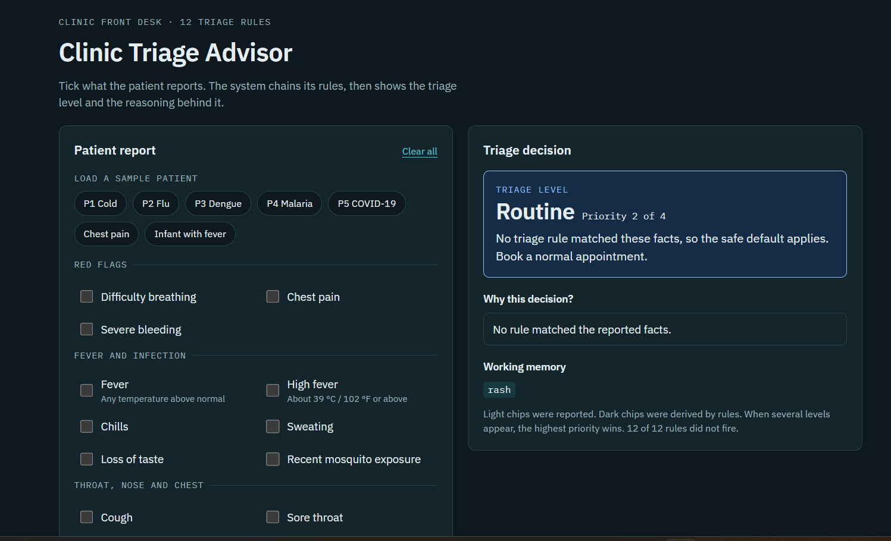
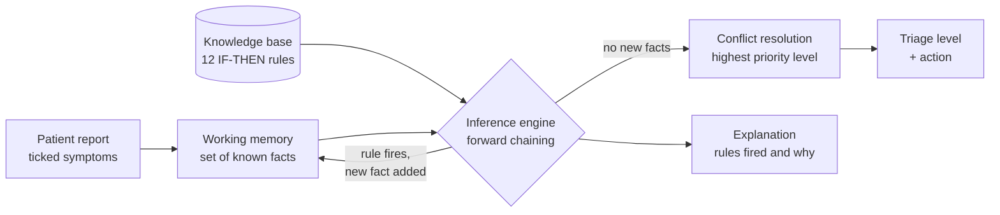

<div align="center">

# 🩺 Clinic Triage Advisor

**A rule-based expert system that triages patients and shows its reasoning, step by step.**

[](#tech-stack)
[](#tech-stack)
[](#tech-stack)
[](#tech-stack)
[](#how-it-works)
[](#knowledge-base)

<br>



</div>

---

> [!WARNING]
> This is an **educational project** built for a knowledge engineering lab. It is **not medical advice** and does not replace a doctor. In a real emergency, call your local emergency number.

## Table of contents

- [Overview](#overview)
- [Features](#features)
- [Quick start](#quick-start)
- [How it works](#how-it-works)
  - [Architecture](#architecture)
  - [Knowledge base](#knowledge-base)
  - [Inference engine](#inference-engine)
  - [Conflict resolution](#conflict-resolution)
  - [Worked example](#worked-example)
- [Sample patients and expected results](#sample-patients-and-expected-results)
- [Project structure](#project-structure)
- [Extending the system](#extending-the-system)
- [Design decisions](#design-decisions)
- [Accessibility](#accessibility)
- [Tech stack](#tech-stack)
- [Limitations](#limitations)
- [Roadmap](#roadmap)
- [Contributing](#contributing)
- [Author](#author)

## Overview

At a clinic front desk, someone has to decide quickly how urgently a patient needs to be seen. Clinic Triage Advisor models that decision as a **rule-based expert system**: you tick the symptoms a patient reports, the system chains its rules together, and it returns one of four triage levels along with a full explanation of *why*.

The explanation is the point. A black-box answer is useless in a clinical setting, so the app shows every rule that fired, the facts each rule used, and which facts were derived rather than reported.

| Level | Priority | Action |
| :---- | :------: | :----- |
| 🔴 **Emergency** | 4 | Send to the emergency room now. |
| 🟠 **Urgent** | 3 | Patient should see a doctor today. |
| 🔵 **Routine** | 2 | Book a normal appointment. |
| 🟢 **Self-care** | 1 | Rest and drink fluids. See a doctor if symptoms get worse. |

## Features

- **Symptom checklist** grouped into red flags, fever and infection, throat/nose/chest, body and stomach, and patient background
- **Seven sample patients** you can load in one click (cold, flu, dengue, malaria, COVID-19, chest pain, infant with fever)
- **Forward-chaining inference engine** that keeps deriving new facts until nothing new can be concluded
- **"Why this decision?" panel** listing each rule that fired, the pass it fired in, and the facts it used
- **Working memory view** that separates reported facts from facts derived by rules
- **Live knowledge base table** that highlights the rules that fired for the current patient
- **Data-driven rules**: add or change a rule without touching the engine
- **Responsive layout** with automatic light and dark mode
- **Zero dependencies**: plain HTML, CSS and JavaScript, no build step, no server

## Quick start

No installation needed.

```bash
# 1. Clone the repository
git clone https://github.com/Shambhavi2110/clinic-triage-advisor.git
cd clinic-triage-advisor

# 2. Open the app in your browser
open index.html          # macOS
xdg-open index.html      # Linux
start index.html         # Windows
```

Or just double-click `index.html`. To serve it locally instead:

```bash
python3 -m http.server 8000
# then visit http://localhost:8000
```

> The IBM Plex fonts load from Google Fonts. Offline, the page falls back to system fonts and works the same otherwise.


## How it works

### Architecture



The three classic parts of an expert system map directly onto the code:

| Expert system part | Where it lives |
| :----------------- | :------------- |
| Knowledge base | the `RULES` array in `script.js` |
| Working memory | the `wm` object built inside `infer()` |
| Inference engine | the `infer()` function in `script.js` |
| Explanation facility | the "Why this decision?" panel built by `render()` |

### Knowledge base

Rules are stored as plain data. Each rule uses up to three kinds of condition:

| Field | Meaning |
| :---- | :------ |
| `all` | every listed fact must be present |
| `any` | at least one listed fact must be present |
| `none` | none of the listed facts may be present |

`then` is the fact the rule adds to working memory when it fires.

| Rule | IF | THEN |
| :--- | :-- | :--- |
| **R1** | high fever | fever |
| **R2** | breathing difficulty | level Emergency |
| **R3** | chest pain | level Emergency |
| **R4** | severe bleeding | level Emergency |
| **R5** | high fever **AND** rash **AND** joint pain **AND** mosquito exposure | suspected dengue |
| **R6** | fever **AND** chills **AND** sweating **AND** mosquito exposure | suspected malaria |
| **R7** | fever **AND** cough **AND** loss of taste | suspected COVID-19 |
| **R8** | suspected dengue **OR** suspected malaria **OR** suspected COVID-19 | level Urgent |
| **R9** | persistent vomiting **AND** abdominal pain | level Urgent |
| **R10** | fever **AND** high-risk patient | level Urgent |
| **R11** | fever **AND** (cough **OR** sore throat) | level Routine |
| **R12** | sneezing **AND** runny nose **AND NOT** fever | level Self-care |

In code, R11 and R12 look like this:

```js
{ id: "R11", all: ["fever"], any: ["cough", "sore_throat"], then: "level_routine" },
{ id: "R12", all: ["sneezing", "runny_nose"], none: ["fever"], then: "level_self_care" }
```

### Inference engine

The engine uses **forward chaining** (data-driven reasoning):

1. Working memory starts with the facts the user ticked.
2. In each pass, every rule that has not fired yet is checked against working memory, in the order they appear in the knowledge base.
3. A rule whose conditions are met **fires** and adds its conclusion to working memory straight away.
4. Passes repeat until a full pass adds no new fact (a *fixed point*).

Every rule fires at most once, so the loop always terminates.

Because a rule's conclusion is added to working memory immediately, later rules in the same pass can already use it. That is why rule order matters, see [Design decisions](#design-decisions).

### Conflict resolution

Several levels can end up in working memory at once. For example, a COVID-19 suspect gets both *Urgent* (via R8) and *Routine* (via R11). The engine resolves this by **highest priority wins**: Emergency (4) beats Urgent (3), which beats Routine (2), which beats Self-care (1).

If no rule produces a level, the app falls back to **Routine** as the safe default and says so on screen.

### Worked example

**Patient P3**: high fever, rash, joint pain, recent mosquito exposure.

| Step | Rule | Facts used | Adds to working memory |
| :--: | :--: | :--------- | :--------------------- |
| 1 | R1 | high fever | `fever` |
| 2 | R5 | high fever, rash, joint pain, mosquito exposure | `suspected dengue` |
| 3 | R8 | suspected dengue | `level Urgent` |

R1, R5 and R8 all fire in pass 1, because each conclusion is available to the rules checked after it. A second pass finds nothing new, so the engine stops. The only level in working memory is Urgent, so the decision is **Urgent, priority 3 of 4**.

## Sample patients and expected results

Use these to check that your build behaves correctly.

| Sample | Reported facts | Rules fired | Result |
| :----- | :------------- | :---------- | :----- |
| P1 Cold | sneezing, runny nose, sore throat | R12 | 🟢 Self-care |
| P2 Flu | high fever, cough, sore throat | R1, R11 | 🔵 Routine |
| P3 Dengue | high fever, rash, joint pain, mosquito exposure | R1, R5, R8 | 🟠 Urgent |
| P4 Malaria | fever, chills, sweating, mosquito exposure | R6, R8 | 🟠 Urgent |
| P5 COVID-19 | fever, cough, loss of taste | R7, R8, R11 | 🟠 Urgent |
| Chest pain | chest pain | R3 | 🔴 Emergency |
| Infant with fever | fever, high-risk patient | R10 | 🟠 Urgent |

## Project structure

```
clinic-triage-advisor/
├── index.html        # page structure and containers
├── style.css         # styling, light/dark themes, responsive layout
├── script.js         # knowledge base, inference engine, rendering
│   screenshot.png
└── README.md
```

## Extending the system

The knowledge base, form, sample buttons and rules table are all generated from data at the top of `script.js`, so most changes need no HTML edits.

**Add a rule**

```js
{ id: "R13", all: ["fever", "rash"], then: "suspected_measles" }
```

**Add a symptom**

1. Add an entry to `FORM` so it shows up as a checkbox: `["rash", "Rash"]`
2. Add its display text to `LABEL`.

**Add a derived condition or triage level**

1. Add a display name to `LABEL`.
2. For a new triage level, also add it to `LEVELS` with a `rank`, `name`, CSS class (`cls`) and `action` text, and add a matching `.level.<cls>` colour style in `style.css`.

**Add a sample patient**

```js
{ name: "Stomach bug", facts: ["persistent_vomiting", "abdominal_pain"] }
```

## Design decisions

**Rules are data, not code.** The engine never changes when the knowledge changes. This is the core idea of knowledge engineering: separate *what the system knows* from *how it reasons*.

**R1 comes before R12 on purpose.** R12 uses a `none: ["fever"]` condition. If R12 ran before R1 had derived `fever` from `high_fever`, a patient with a high fever plus sneezing and a runny nose could wrongly be classed as Self-care. Listing R1 first guarantees `fever` is in working memory before R12 is tested. This is a small example of **negation as failure**: "not fever" only means "fever is not currently known".

**Highest priority wins.** Patient safety favours the more severe outcome, so the engine always reports the most urgent level it can justify.

**Safe default.** If nothing matches, the app says "Routine" and tells you no rule fired, instead of showing a blank or misleading result.

**Everything is explainable.** Each fired rule is recorded with the pass number and the exact facts that triggered it, which powers the explanation panel and the highlighted rows in the knowledge base table.

**Safe rendering.** The UI is built with `textContent` and DOM methods rather than HTML strings, so nothing typed or ticked can inject markup.

## Accessibility

- Every control is a real `<input>` or `<button>`, so it works with the keyboard and screen readers
- Fieldsets and legends group the symptom checkboxes
- The decision panel is an `aria-live` region, so changes are announced
- Sample buttons expose their state with `aria-pressed`
- Visible focus outlines on all interactive elements
- Level colours are always paired with a text label, so colour is never the only signal
- Respects `prefers-color-scheme` and `prefers-reduced-motion`

## Tech stack

| Layer | Choice |
| :---- | :----- |
| Markup | HTML5 |
| Styling | CSS3 with custom properties, grid and `prefers-color-scheme` |
| Logic | Vanilla JavaScript, no libraries |
| Fonts | IBM Plex Sans and IBM Plex Mono (Google Fonts) |
| Hosting | Any static host, such as GitHub Pages |

## Limitations

- Covers a small set of conditions with simplified rules, for teaching purposes only
- Facts are either present or absent, so there is no uncertainty, probability or severity scale
- No patient age, vital signs or symptom duration beyond the "high-risk" flag
- Nothing is stored or sent anywhere, and there is no patient record

## Roadmap

- [ ] Numeric inputs (temperature, heart rate, oxygen saturation) turned into facts by rules
- [ ] Backward-chaining mode: pick a hypothesis and ask which facts are missing
- [ ] Rule editor in the UI
- [ ] Export the explanation as text or PDF
- [ ] Certainty factors for rules
- [ ] Unit tests for the inference engine

## Contributing

Suggestions and improvements are welcome.

1. Fork the repository
2. Create a branch: `git checkout -b feature/your-idea`
3. Commit your changes: `git commit -m "Add your idea"`
4. Push the branch: `git push origin feature/your-idea`
5. Open a pull request

If you add or change a rule, please also update the [rules table](#knowledge-base) and the [expected results](#sample-patients-and-expected-results) in this README.


## Author

**Shambhavi**
Final year engineering student-IGDTUW, Computer Science and Engineering

GitHub: [Shambhavi Sahoo](https://github.com/shambhavi2110)

<div align="center">

<sub>Built for a knowledge engineering lab. Not a medical device.</sub>

</div>